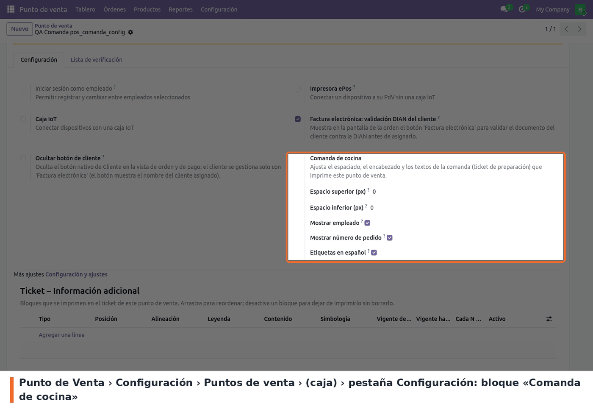

En *Punto de Venta › Configuración › Puntos de venta*, abrir la caja y, en la pestaña
**Configuración**, ir al bloque **Comanda de cocina**:

- **Espacio superior (px)** — 0 por defecto, de 0 a 100: blanco arriba de la comanda.
- **Espacio inferior (px)** — 0 por defecto, de 0 a 100: blanco al final del cuerpo.
- **Mostrar empleado** — marcado por defecto: línea «Atendido por: …».
- **Mostrar número de pedido** — marcado por defecto: línea «Pedido # N». No afecta al piso ni a
  la mesa.
- **Etiquetas en español** — marcado por defecto. Desmarcado, se usa el texto de Odoo en el idioma
  del usuario.

Para imprimir comandas, la caja necesita al menos una impresora de preparación. Los cambios se
aplican la próxima vez que se carga el POS, y se pueden hacer con la sesión abierta.
