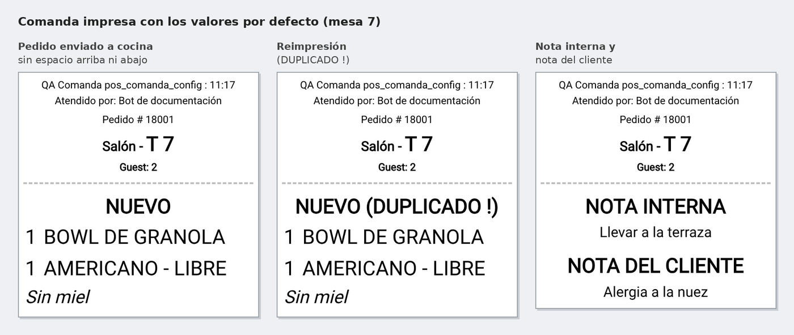
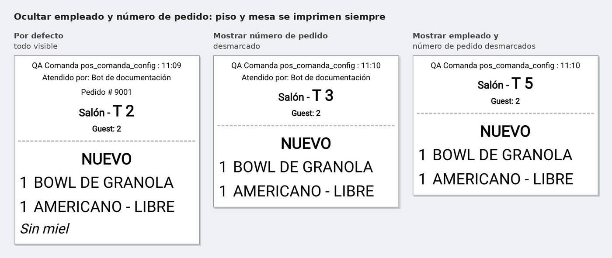
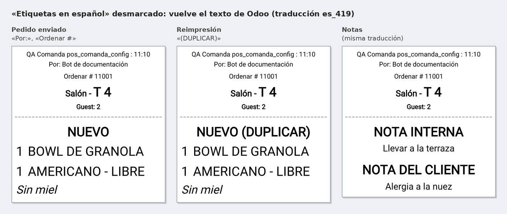
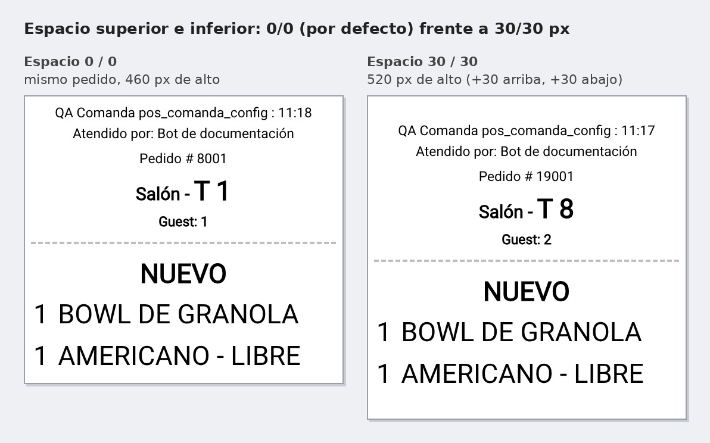

No hay nada que hacer en la caja: al enviar el pedido a cocina (*Enviar* en restaurante, o al
validar el pago en una caja sin mesas), la comanda sale con la configuración de esa caja. Con los
valores por defecto sale sin blanco arriba ni abajo y con las etiquetas en español, también en
la reimpresión (ícono de cubiertos) y en la comanda de notas:

Al ocultar el empleado o el número de pedido, el piso y la mesa siguen impresos:

Con **Etiquetas en español** desmarcado vuelve el texto de Odoo en el idioma del usuario:

El espacio superior e inferior se suma al papel impreso, sin cambiar el contenido:

