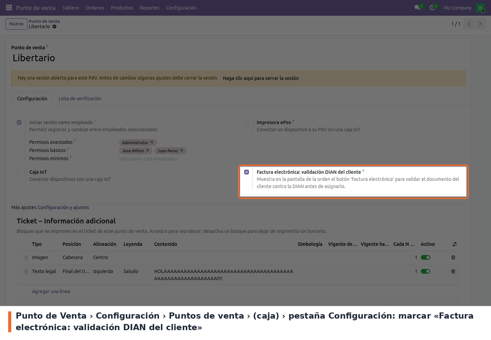

## Requisitos

- Módulo `l10n_co_edi_jorels` instalado, con la **facturación electrónica habilitada** en la
  compañía. Si no lo está, el popup responde "La facturación electrónica no está habilitada en esta
  compañía".
- **Token Edipo** en la compañía: *Ajustes › Facturación electrónica colombiana*, campo
  **Edipo api key** (`api_key`). Es el mismo que usa la instancia para facturar. Sin él, el popup
  responde "No está configurado el token de Edipo"; si el token no es válido, avisa que no está
  autorizado.
- **Municipio de la compañía** (campo *Municipality* de facturación electrónica). Los clientes nuevos
  y los existentes que no tienen municipio toman el de la compañía. Si la compañía tampoco lo tiene,
  el cliente existente se informa como incompleto y no se asigna, y el cliente nuevo **se crea sin
  municipio** (ver *Known issues / Roadmap*).
- **Permisos del cajero:** usuario del Punto de Venta. Para *Crear y asignar* o *Asignar y
  actualizar* necesita además permiso de creación y edición de contactos; sin él, el popup lo
  informa y no escribe nada.

## Activar el botón en cada caja

En *Punto de Venta › Configuración › Puntos de venta*, abrir la caja y, en la pestaña
**Configuración**, marcar **Factura electrónica: validación DIAN del cliente**. El ajuste viene
marcado de forma predeterminada; desmarcarlo oculta los botones *Factura electrónica* en esa caja.
El botón *Guardar orden* queda oculto igual, con el ajuste marcado o no.

Justo debajo está **Ocultar botón de cliente** (viene desmarcado): al marcarlo, el botón nativo de
*Cliente* desaparece de la vista de orden (escritorio y móvil) y de la vista de pago, y
*Factura/Recibo* ocupa todo el ancho. El cliente se gestiona entonces solo con *Factura
electrónica*, que muestra debajo el nombre del cliente ya asignado. Con esta opción no hay forma de
desasignar un cliente desde la interfaz.

La caja puede tener una sesión abierta mientras se cambia el ajuste. El POS lo toma la próxima vez
que se carga.

## Opcional

La URL del servicio se cambia con el parámetro de sistema `jorels.edipo.api_url` (por defecto
`https://edipo.jorels.com`).
