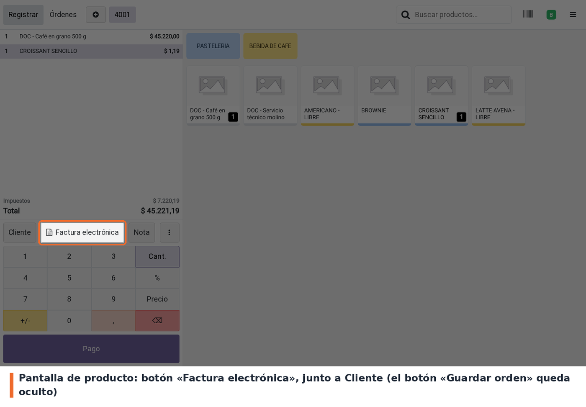
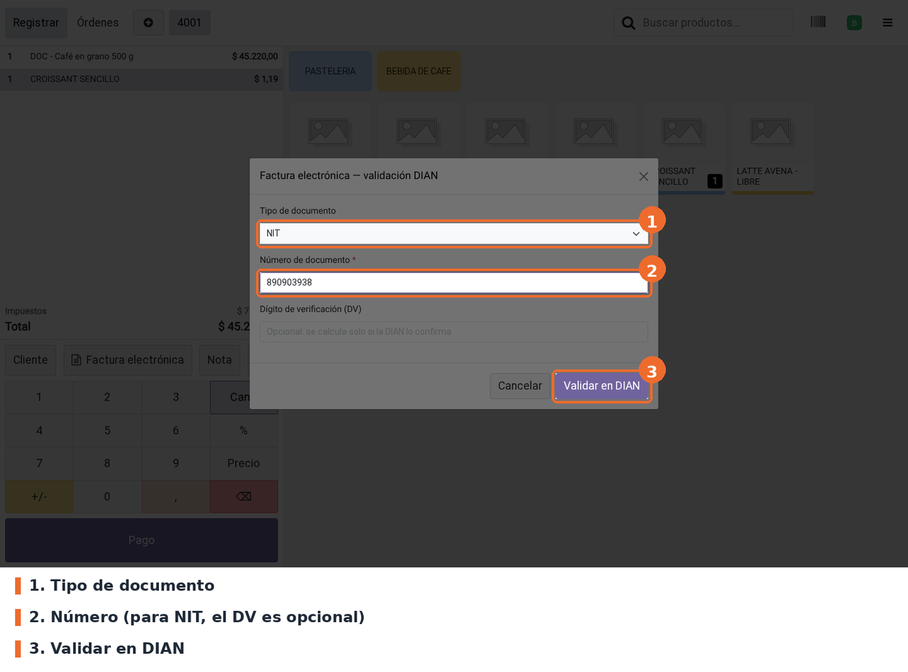
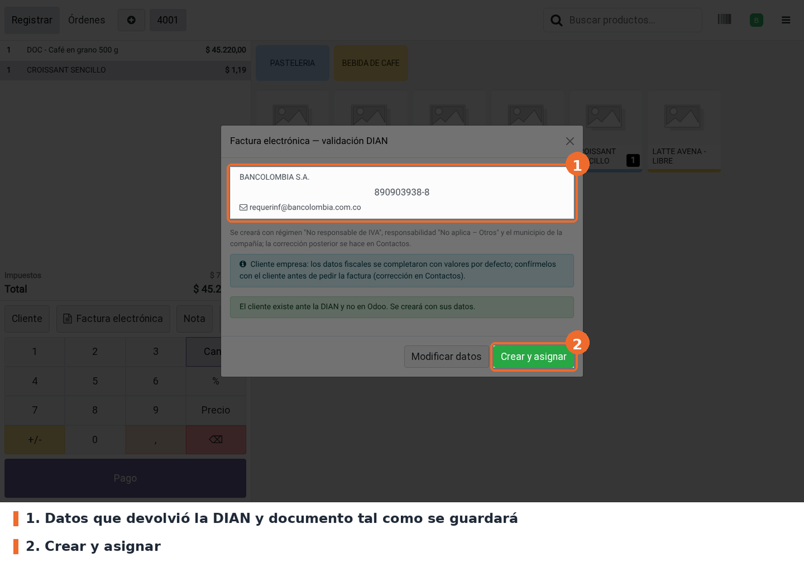
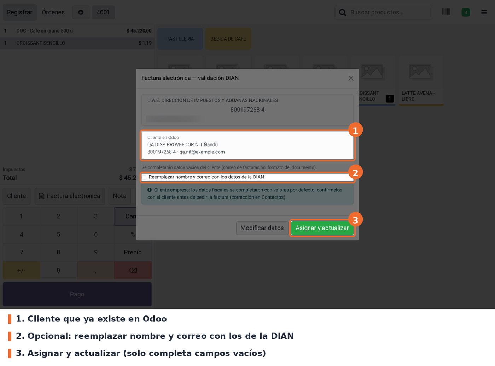
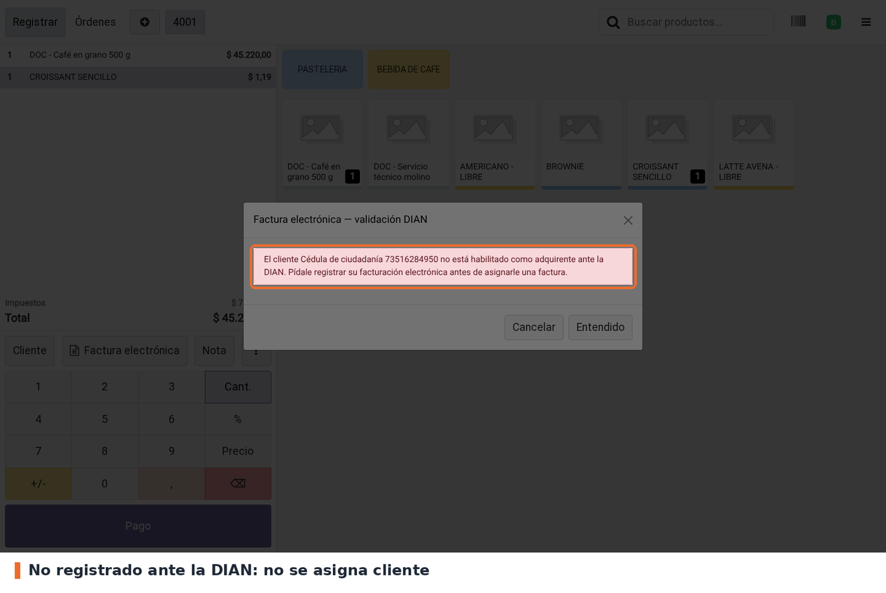
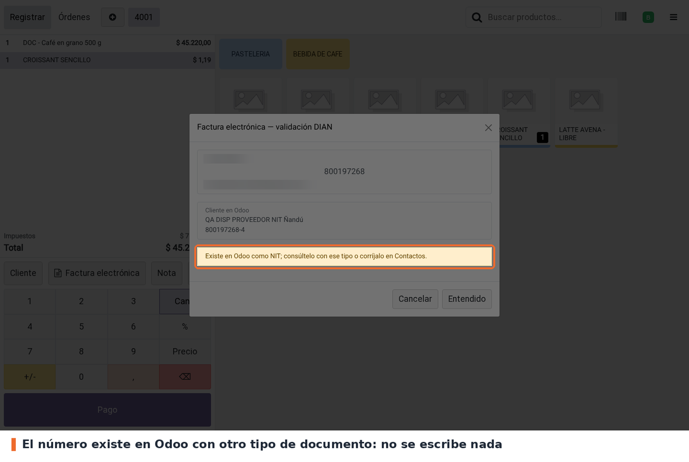
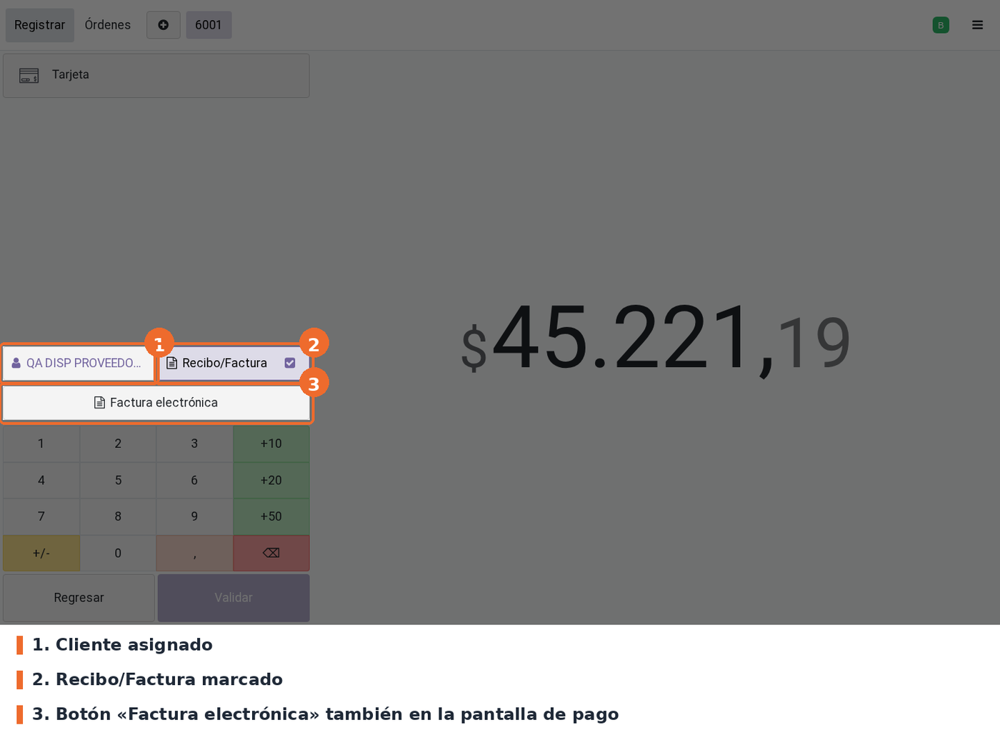
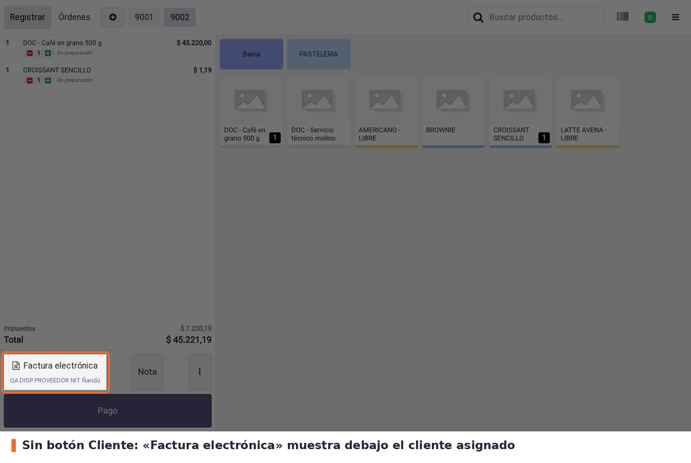
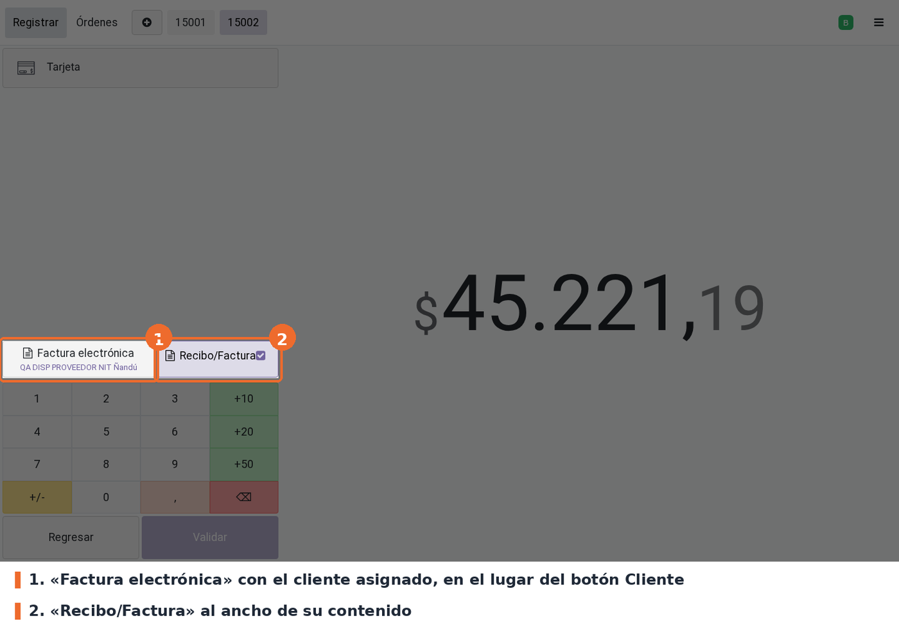

## 1. Abrir el popup

En la pantalla de producto, con la orden en curso, pulsar **Factura electrónica**, a la derecha de
*Cliente*. En pantallas chicas el botón aparece en la barra de acciones como **FE**. También está
en la pantalla de pago, debajo de *Cliente* y *Recibo/Factura*.

Las órdenes con devoluciones no permiten cambiar el cliente: el botón muestra un aviso y no abre el
popup.

## 2. Digitar el documento

Elegir el **tipo de documento**, escribir el **número** y pulsar **Validar en DIAN**. Para NIT, el
dígito de verificación es opcional. Se aceptan también `NIT-DV` (p.ej. `890903938-8`) y el NIT de
10 dígitos con el DV pegado, si empieza por 8 o 9. Un DV que no corresponde se rechaza e indica el
correcto. El documento genérico de consumidor final (`222222222222`) se rechaza: para ese caso se
usa el botón *Cliente*.

## 3. Revisar la previsualización y confirmar

Arriba aparecen el nombre que registró la DIAN, el documento en grande tal como se guardará y el
correo. **Confirmar con el cliente** que el nombre y el correo son los suyos. Si algo no coincide,
**Modificar datos** vuelve al paso anterior.

Cliente nuevo en Odoo: **Crear y asignar**. Se crea con los datos de la DIAN y los valores fiscales
por defecto. En empresas (NIT), un aviso azul pide confirmar los datos fiscales con el cliente.

Cliente que ya existe en Odoo: se muestra debajo de los datos de la DIAN. **Asignar y actualizar**
completa los campos vacíos (correo de facturación, municipio, régimen, responsabilidad, formato del
NIT) y actualiza el **correo de facturación electrónica** con el de la DIAN. El **nombre** y el
**correo del contacto** no se pisan: si el nombre difiere, el popup pide confirmar con el cliente
que es el mismo (las diferencias de comas, tildes u orden de palabras no cuentan); el correo del
contacto solo se completa si estaba vacío. Si no hay nada que actualizar, el botón dice **Asignar
cliente**.

El popup recuerda que la factura se enviará al correo de facturación electrónica con copia al correo
de contacto (el envío lo gestiona la configuración de facturación electrónica de la compañía).

Al confirmar, el popup se cierra, el cliente queda en la orden y aparece la notificación
"Cliente … asignado para factura electrónica".

## 4. Casos en que no se asigna

Si la DIAN no tiene registrado el documento, el cliente tiene que habilitarse como adquirente ante
la DIAN. Se cierra con **Entendido**.

Si el número ya existe en Odoo con **otro tipo de documento** (p.ej. guardado como NIT y consultado
como cédula), el popup no escribe nada y avisa en amarillo con qué tipo existe. Hay que consultarlo
con ese tipo o corregir el contacto en *Contactos*.

## 5. Cobrar

En la pantalla de pago, el cliente aparece asignado y **Recibo/Factura** marcado. Al validar el
pago, la factura sale a nombre de ese cliente y `l10n_co_edi_jorels` la envía a la DIAN.

El botón de factura nativo de Odoo se llama *Invoice*; con el idioma Español (Latinoamérica) se lee
**Recibo/Factura** y con Español (España) **Factura**. Es el mismo botón.

## 6. Cajas con «Ocultar botón de cliente»

Si la caja tiene marcados **los dos** ajustes (*Factura electrónica: validación DIAN del cliente* y
*Ocultar botón de cliente*), el botón nativo *Cliente* no aparece y todo se hace con **Factura
electrónica**:

**Pantalla de producto** (escritorio y barra de acciones móvil): queda *Factura electrónica* (o
*FE* en pantallas chicas) en lugar de *Cliente*. Una vez asignado, el nombre del cliente aparece
debajo del botón (en móvil, al lado de *FE*).

**Pantalla de pago:** *Factura electrónica* ocupa el lugar del botón *Cliente*, en la misma fila
que *Recibo/Factura* y con el nombre del cliente asignado debajo; *Recibo/Factura* queda al ancho
de su contenido. En pantallas chicas los dos botones se apilan, igual que en el POS estándar. Si la orden exige cliente (por ejemplo, porque se marcó
*Recibo/Factura*) y todavía no lo tiene, *Factura electrónica* se **resalta** con el color
principal del POS, igual que se resaltaba el botón *Cliente* nativo.

Con este modo **no hay forma de desasignar un cliente desde la interfaz**: si se asignó el cliente
equivocado, se valida y asigna el correcto con *Factura electrónica* (reemplaza al anterior) o se
descarta la orden.

## Estados y mensajes del popup

- **Cliente nuevo** (`create_ok`): "El cliente existe ante la DIAN y no en Odoo. Se creará con sus
  datos." Botón *Crear y asignar*.
- **Falta correo** (`needs_email`): "La DIAN confirmó a … pero no tiene correo registrado". Pide el
  correo al cajero (obligatorio y con formato válido) y luego *Crear y asignar*. Los correos de
  relleno de la DIAN (`sininformacion@…`, `sincorreo@…`) cuentan como "sin correo".
- **Cliente existente** (`found`): muestra el cliente de Odoo. Botón *Asignar cliente* o *Asignar y
  actualizar*.
- **No registrado** (`not_registered`): "El cliente … no está habilitado como adquirente ante la
  DIAN". Botón *Entendido*.
- **Otro tipo de documento** (`type_mismatch`): "Existe en Odoo como …; consúltelo con ese tipo o
  corríjalo en Contactos". Aviso amarillo, no escribe nada.
- **Duplicado** (`ambiguous`): "Hay más de un contacto con este documento". Lista los contactos y
  hay que resolverlo en *Contactos*.
- **Archivado** (`archived`): "El cliente existe en Odoo pero está ARCHIVADO". Hay que reactivarlo
  en *Contactos*.
- **Incompleto** (`incomplete`): "El cliente existe en Odoo pero le falta: …" (correo de facturación
  sin correo de la DIAN para completarlo, o municipio sin municipio en la compañía).
- **Dato inválido** (`invalid`): número vacío, NIT de menos de 7 dígitos, DV que no concuerda,
  documento de consumidor final, correo con formato inválido. Botón *Modificar datos*.
- **Configuración** (`config_error`): facturación electrónica deshabilitada, token ausente o no
  autorizado. Botón *Cerrar*.
- **Conexión** (`connection_error`): "La DIAN no respondió (…). Reintente en unos segundos." Botón
  *Reintentar*.
- **Respuesta inesperada** (`unexpected_response`): el servicio rechazó la consulta o respondió
  algo que no se reconoce. Botón *Reintentar*.
- **Permisos** (`permission_error`): el usuario no puede leer, crear o editar contactos. Botón
  *Cerrar*.

En todos los casos que no son de asignación, la orden queda como estaba.
