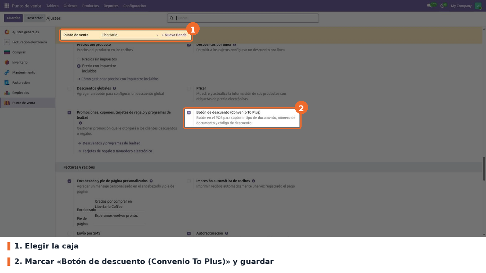
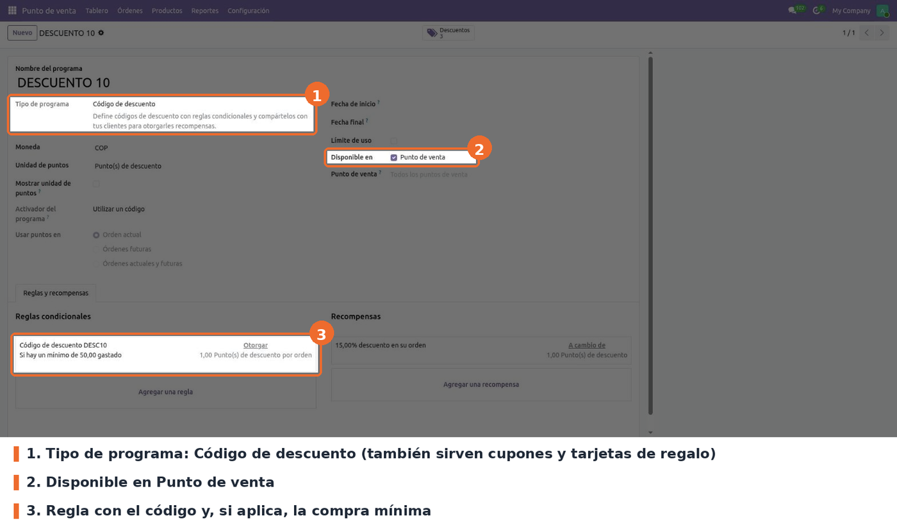

**Botón por caja.** En *Punto de Venta › Configuración › Ajustes*, elegir la caja en el selector
superior y, en el bloque de precios y descuentos, marcar **Botón de descuento (Convenio To Plus)**.
Viene marcado por defecto. Desmarcado, esa caja vuelve a mostrar el «Enter Code» de Odoo.

El botón aparece solo si la caja tiene cargado al menos un programa canjeable con código.

**Programas de descuento.** En *Punto de Venta › Productos › Descuentos y lealtad*, crear el
programa con *Disponible en: Punto de venta*. Sirven los tipos **Código de descuento**,
**Cupones**, **Promociones** (con regla de código), **Tarjeta de regalo** y **Cupones para la
próxima orden**; las tarjetas de lealtad por puntos no se canjean con este botón.

- Un descuento fijo nunca supera el total de la orden. Si el bono no debe usarse en compras
  menores a su valor, configurar una **compra mínima** en la regla del código.
- Un código promocional no guarda saldo; para eso se usa una tarjeta de regalo.
- Los cambios en los programas llegan a la caja la próxima vez que se carga el POS.
