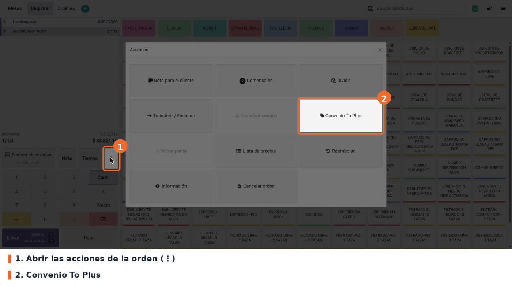
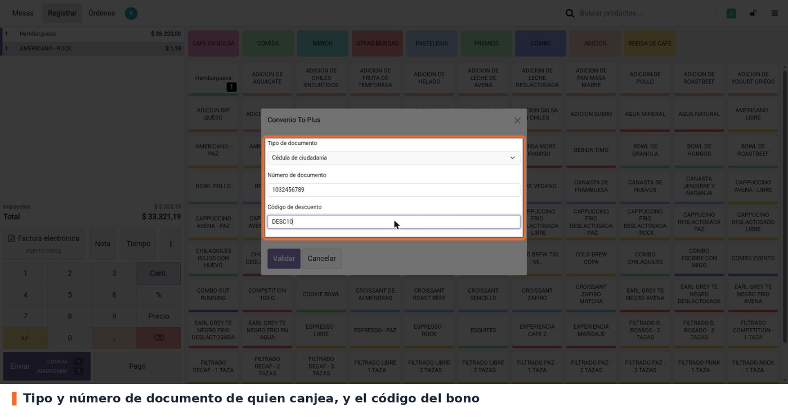
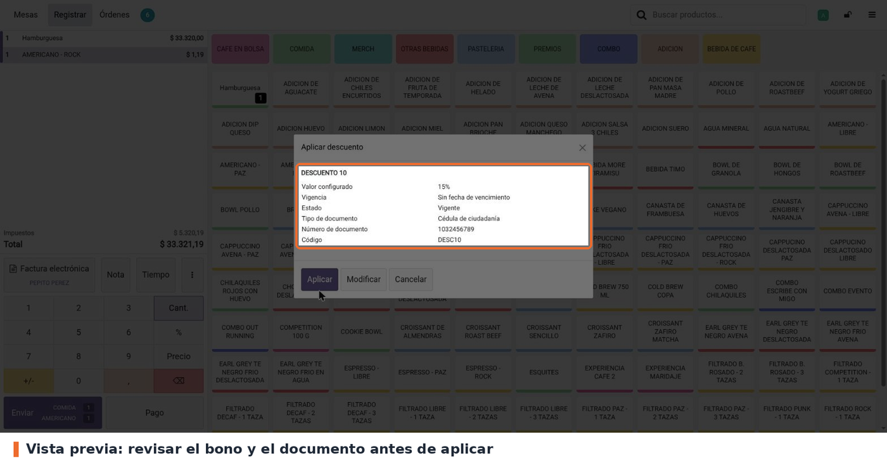
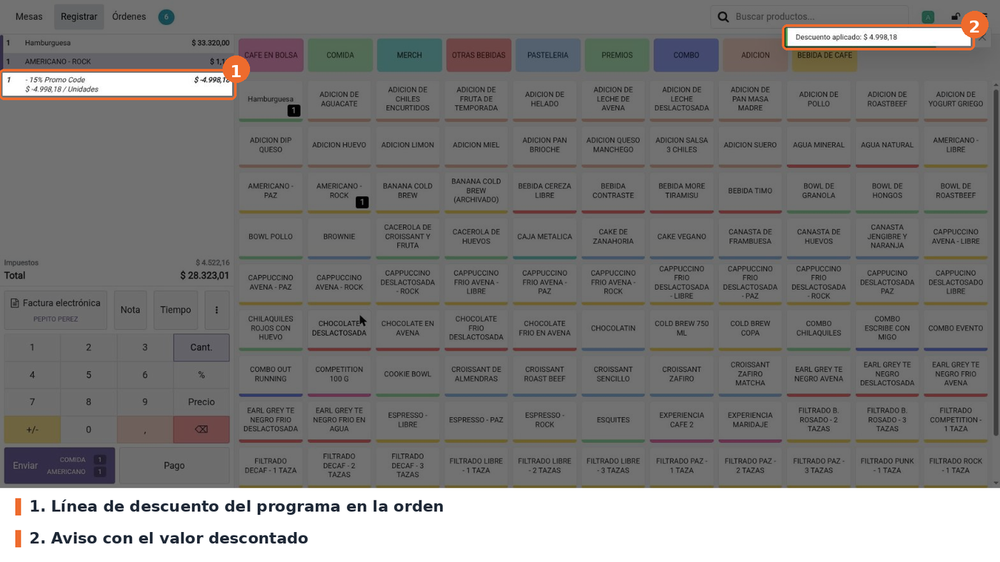
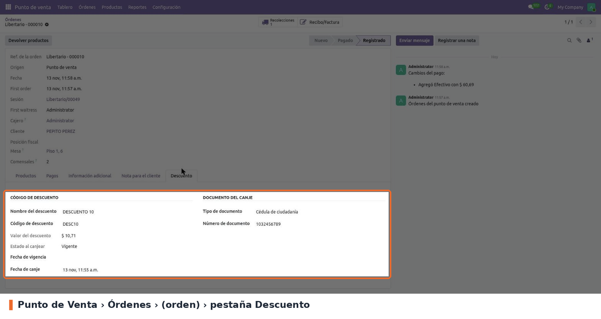

Con los productos ya en la orden, abrir las acciones (**⋮**) y pulsar **Convenio To Plus**:

Elegir el tipo de documento, escribir el número y el código, y pulsar **Validar**. Los errores
(número vacío o con puntos, código inexistente, vencido o ya aplicado) se muestran en el mismo
formulario:

La vista previa muestra el bono y el documento. **Modificar** vuelve al formulario y **Aplicar**
activa el código en la orden:

El descuento queda como una línea más de la orden y un aviso muestra el valor descontado:

Si la orden todavía no cumple las condiciones del bono (por ejemplo, la compra mínima), el código
queda activado con el aviso «el descuento se aplicará cuando la orden cumpla las condiciones del
bono». La línea aparece sola cuando se cumplan, también si la orden se envió antes a cocina.

Se cobra normalmente. Al sincronizar la orden pagada, el servidor registra el canje en la pestaña
**Descuento** de la orden:

## Qué se guarda en la orden

- **Nombre del descuento** y **programa**: los del programa, no lo que envía la caja.
- **Código de descuento**: el digitado en la caja.
- **Valor del descuento**: suma de las líneas de descuento del programa, con impuestos. Se
  recalcula si cambian las líneas.
- **Fecha de vigencia**: la fecha final del programa.
- **Estado al canjear**: vigente o vencido **en la fecha del canje**, según el día local del
  cajero. No cambia aunque el programa venza después.
- **Tipo y número de documento**: los digitados; en los tipos numéricos se quitan espacios, puntos
  y guiones.
- **Fecha de canje**: el momento en que se aplicó el código.

## Reglas del servidor

- El canje se registra solo si, **al cobrar**, el programa existe, el código es de ese programa
  (regla con código o tarjeta) y la orden tiene al menos una línea de descuento del programa. Si
  no, los campos quedan vacíos.
- Mientras la orden está en borrador (mesa abierta, enviada a cocina) el canje se conserva aunque
  todavía no haya línea de descuento.
- Un dato inválido nunca impide que la orden se sincronice.
- En órdenes pagadas, los datos del canje no se pueden modificar.

## Pruebas

Las pruebas automáticas de la lógica del servidor están en `tests/test_discount_code.py` (22
casos). Se corren en una base de pruebas, nunca en una base real, con
`odoo -d <base_de_pruebas> -i pos_discount_code --test-enable --test-tags /pos_discount_code --stop-after-init`.

El popup se prueba a mano en una caja, recargándola después de actualizar el módulo:

1. Código válido sobre la compra mínima: línea de descuento y aviso con el valor.
2. El mismo código otra vez: «Este código ya fue aplicado en la orden.»
3. Otro código: aviso de reemplazo en la vista previa; queda solo el nuevo descuento.
4. Quitar la línea del descuento y volver a aplicar el código: el descuento vuelve.
5. Código inexistente, vencido o aún no vigente: error en el formulario.
6. Cupón o tarjeta de regalo válidos: vista previa con el saldo real.
7. Cédula con puntos: error de solo dígitos. Pasaporte con letras: pasa.
8. Código bajo la compra mínima, orden enviada a cocina, completar la compra y cobrar: canje
   registrado con su valor.
9. Cobrar con el código activado pero sin línea de descuento: la orden queda sin canje.
10. Caja con el ajuste desmarcado: aparece el «Enter Code» de Odoo.
