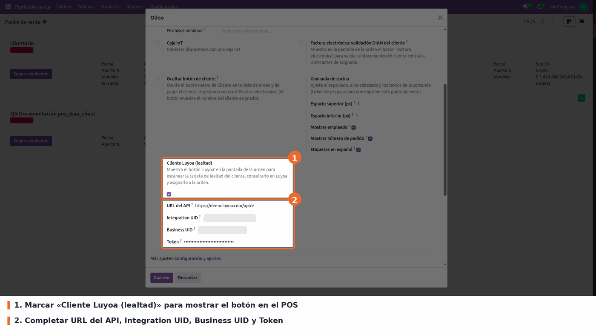

En **Punto de Venta → Configuración → Puntos de venta → (tu tienda) →
pestaña Configuración → Cliente Luyoa (lealtad)**:

1. Marque **Botón Luyoa** para mostrar el botón en el POS.
2. Complete las credenciales (todas obligatorias para usar el botón):

   - **URL del API**: `https://demo.luyoa.com/api/external/v1` (viene por defecto; es el entorno donde está registrado y habilitado el negocio, no la web de la tarjeta del cliente). Las credenciales solo valen en el entorno donde se generaron: al cambiar la URL el formulario muestra una advertencia.
   - **Integration UID**: identificador de la integración (partner). Lo entrega Luyoa al registrar el acceso a la API y debe ser el de la misma integración que generó el token; sin él la API responde `401`.
   - **Business UID**: identificador del negocio, en el dashboard de Luyoa.
   - **Token**: token de autenticación del negocio, en el dashboard de Luyoa. Es información sensible: guárdela con cuidado.

Con el botón marcado, los cuatro campos son obligatorios para guardar la
configuración; además, si falta alguno, el popup informa exactamente qué falta
antes de consultar. Las credenciales solo las ve y edita el responsable del
POS (grupo *Punto de Venta / Administrador*).

La cámara del navegador solo funciona sobre **HTTPS** (en desarrollo,
`localhost` también sirve). En cajas sin cámara, el diálogo de escaneo del
core muestra el motivo y el cajero puede cerrarlo sin perder la orden.
