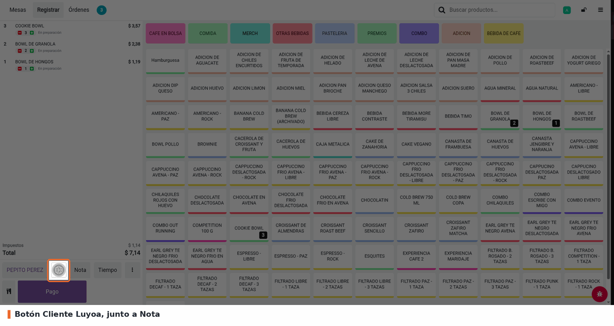
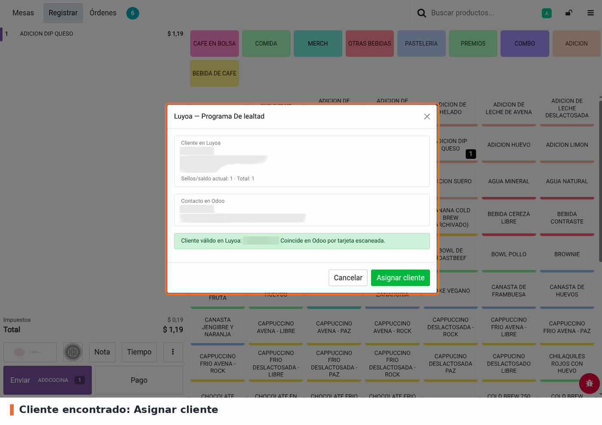
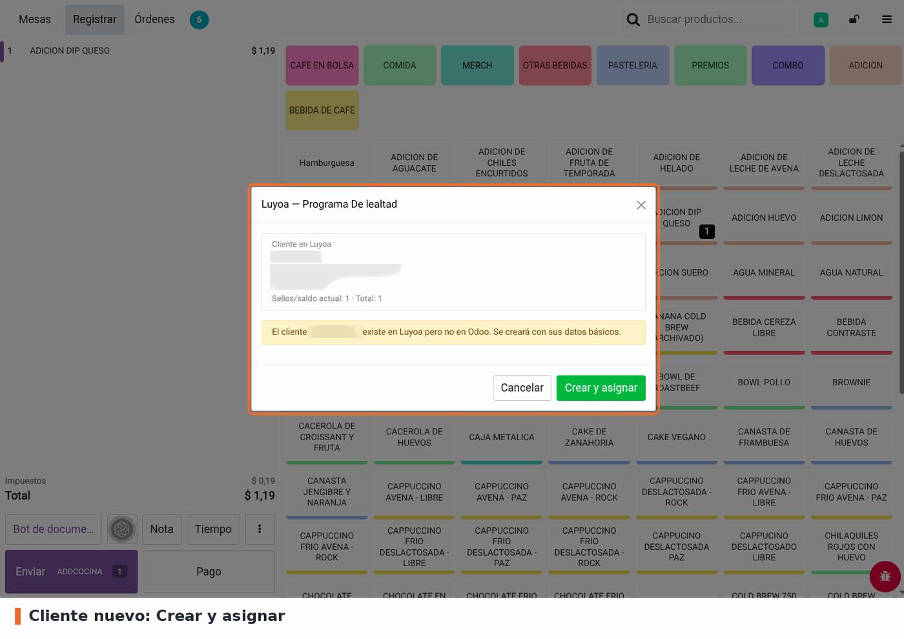
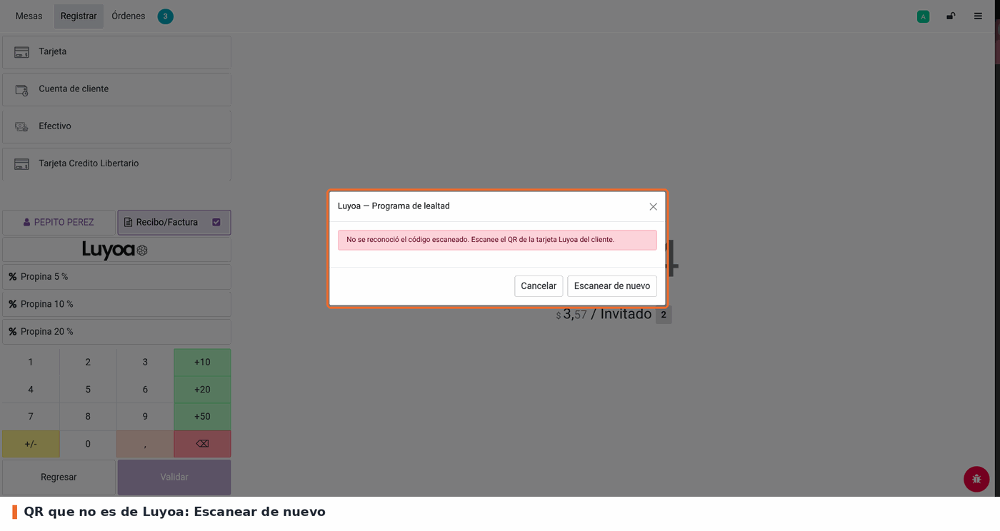
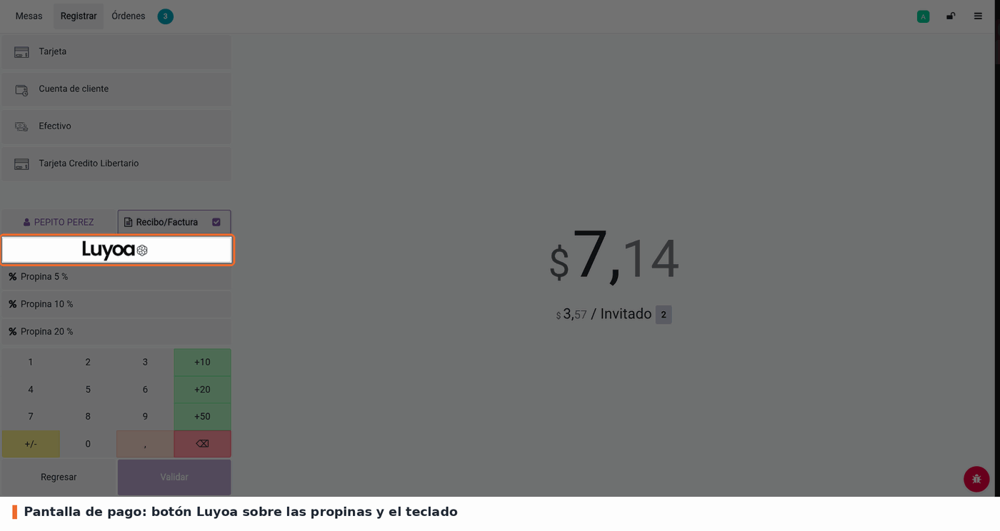

1. Con una orden abierta, toque el botón **Cliente Luyoa**:

   - En desktop: el icono cuadrado junto al botón *Nota*, o *Cliente Luyoa* en el submenú de los 3 puntos.
   - En pantallas pequeñas: el botón *Luyoa* de la barra de acciones (junto a *Cliente*).
   - En la pantalla de pago: el logo de Luyoa sobre el teclado numérico.

2. Se abre la cámara; apunte al QR de la tarjeta digital del cliente
   (Apple/Google Wallet). Si cancela la cámara, el popup queda abierto para
   reintentar.
3. Revise los datos mostrados (cliente de Luyoa y contacto de Odoo) y toque
   **Asignar cliente** o **Crear y asignar**. La orden queda con el cliente
   asignado y marcada para facturar.

Si el cliente ya existe en Odoo, el popup muestra los dos lados y por qué
coincidieron (tarjeta escaneada, correo, o nombre y teléfono):

Si no existe, se ofrece crearlo con su nombre, correo y teléfono de Luyoa:

Cuando el QR no es de una tarjeta de Luyoa, o falla la credencial o la
conexión, el popup explica el motivo y ofrece **Escanear de nuevo** o
**Reintentar**; no se asigna nadie:

El mismo flujo se abre desde la pantalla de pago:

Con dos contactos de Odoo que matchean al mismo cliente, el popup lista los
candidatos y no deja asignar hasta resolverlo en *Contactos*. Un contacto
archivado, o uno ya vinculado a otra tarjeta de Luyoa, también bloquea la
asignación con el aviso correspondiente.
