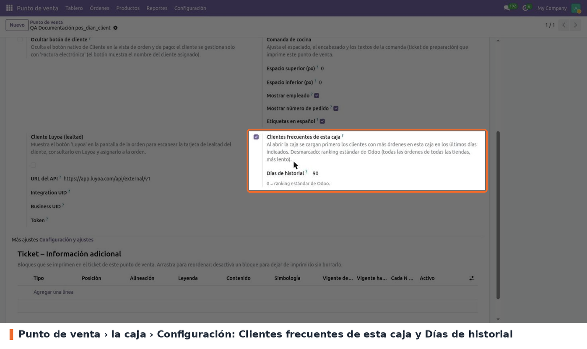

Por caja, en *Punto de venta › Configuración › Punto de venta* → la caja → pestaña
**Configuración**:

- **Clientes frecuentes de esta caja** (`frequent_partners_by_store`). Activado por defecto en
  todas las cajas al instalar. Desmarcado, la caja vuelve al ranking estándar de Odoo.
- **Días de historial** (`frequent_partners_days`). Por defecto **90**. Visible solo con la opción
  anterior marcada. Con **0** se usa el ranking estándar; no admite valores negativos.

La cantidad de clientes que se cargan sigue siendo la del parámetro estándar
`point_of_sale.limited_customer_count` (100 por defecto, en *Ajustes › Técnico › Parámetros del
sistema*).

Los cambios los toma el POS al volver a cargar los datos (menú ☰ → **Recargar datos**).
